


 

&nbsp;&nbsp;
&nbsp;&nbsp;
&nbsp;&nbsp;

 


 


 


 


<table>
<tr>
<td width="50%" align="center" valign="top">
 

<h3>Full Stack Portfolio with Admin Panel</h3>
Next.js · Tailwind CSS · Redux Toolkit · Node.js · Express · MongoDB

REST API with CRUD-managed content, 3D and parallax animations, and a custom admin panel.

<a href="https://rishikeshwebdev.vercel.app/"><b>🔗 Live Demo</b></a>
  
</td>
<td width="50%" align="center" valign="top">
 

<h3>ClickShop – Full Stack E-Commerce</h3>
PHP · MySQL · JavaScript · HTML5 · CSS3 · Bootstrap 5

Product listing, cart, order management, admin panel and a normalized MySQL schema.

<a href="https://clickshop.gamer.gd/"><b>🔗 Live Demo</b></a> &nbsp;·&nbsp; <a href="https://github.com/rishikeshwebdev-droid/ClickShop"><b>💻 Source</b></a>
  
</td>
</tr>
</table>

 


<table>
<tr>
<td width="33%" align="center" valign="top">  <b>MERN Stack Training</b> Techmerise Academy  </td>
<td width="33%" align="center" valign="top">  <b>Mastering Full Stack Web Development</b> Workshop  </td>
<td width="33%" align="center" valign="top">  <b>Pixels &amp; Passion</b> Graphic Design Workshop  </td>
</tr>
</table>

Also: Python Programming Course &amp; Internship – Besant Technologies

 


 
&nbsp;&nbsp;

  
<picture>
<source media="(prefers-color-scheme: dark)" srcset="https://raw.githubusercontent.com/rishikeshwebdev-droid/rishikeshwebdev-droid/output/snake-dark.svg"/>

</picture>

 


 
&nbsp;&nbsp;
&nbsp;&nbsp;

 

